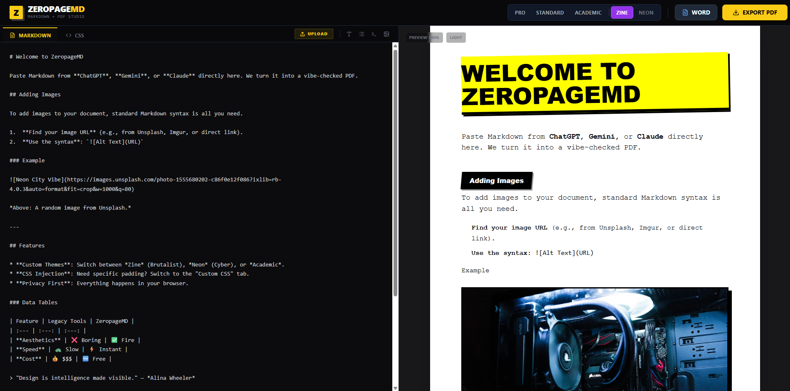

# ZeropageMD

ZeropageMD is a modern, feature-rich Markdown editor and previewer built with React and Vite. It offers a seamless writing experience with real-time preview, syntax highlighting, and advanced formatting capabilities.

## Author

**Manish Kirankumaar** - [Website](https://manishkirankumaar.space/)




## Features

- **Real-time Preview**: Instant rendering of Markdown as you type.
- **Syntax Highlighting**: robust code block highlighting using `highlight.js` and `marked-highlight`.
- **Math Support**: Mathematical equation rendering powered by `KaTeX`.
- **PDF Export**: Built-in functionality to export your documents as high-quality PDFs.
- **Modern UI**: Clean and responsive interface styled with Tailwind CSS and Lucide icons.
- **Custom Parsing**: Enhanced Markdown parsing capabilities for complex structures.

## Getting Started

### Prerequisites

- Node.js (Latest LTS version recommended)

### Installation

1.  Clone the repository:
    ```bash
    git clone https://github.com/suraguru/ZeropageMD.git
    ```

2.  Navigate to the project directory:
    ```bash
    cd ZeropageMD
    ```

3.  Install dependencies:
    ```bash
    npm install
    ```

### Usage

**Development Server**

Start the development server with hot reload:

```bash
npm run dev
```

**Production Build**

Build the application for production:

```bash
npm run build
```

**Preview Production Build**

Preview the built application locally:

```bash
npm run preview
```

## Technologies

- [React](https://reactjs.org/)
- [Vite](https://vitejs.dev/)
- [Tailwind CSS](https://tailwindcss.com/)
- [Marked](https://marked.js.org/)
- [KaTeX](https://katex.org/)
- [Html2Pdf.js](https://github.com/eKoopmans/html2pdf.js)
